# Museify 🎵

**Museify** adalah aplikasi Android penemuan dan pemutaran musik modern yang dibangun menggunakan **Kotlin**, **Jetpack Compose**, dan arsitektur **MVVM (Model-View-ViewModel)** dengan integrasi data real-time dari **Jamendo REST API**.

> **Pengembang:** Bianca Putri  
> **Proyek:** Pemrograman Mobile Kelas XII  
> **Package:** `com.biancaputri.museify`  

---

## 📸 Screenshots Aplikasi

### ☀️ Mode Terang (Light Mode — Bahasa Indonesia)
| Beranda (Dashboard) | Sedang Diputar | Detail Lagu | Pencarian | Favorit | Pengaturan |
|:---:|:---:|:---:|:---:|:---:|:---:|
| 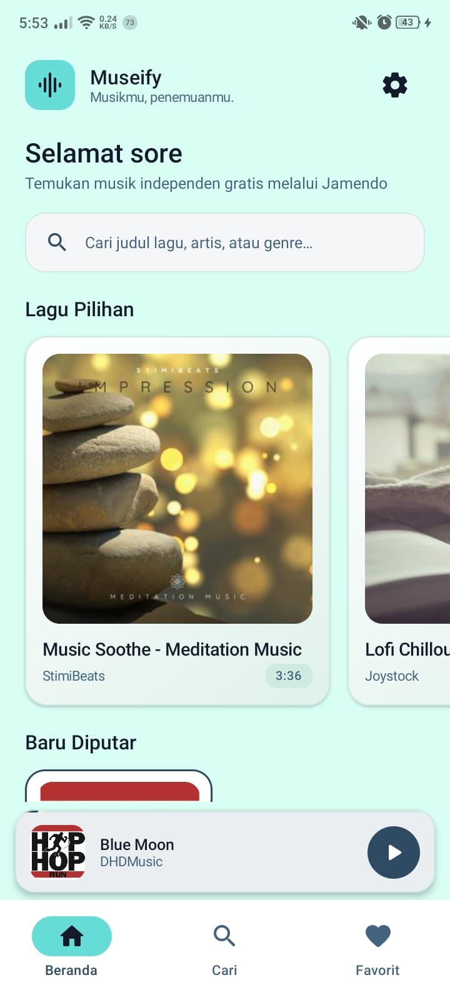 | 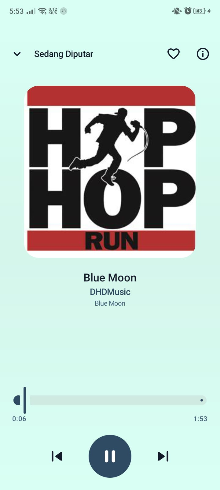 | 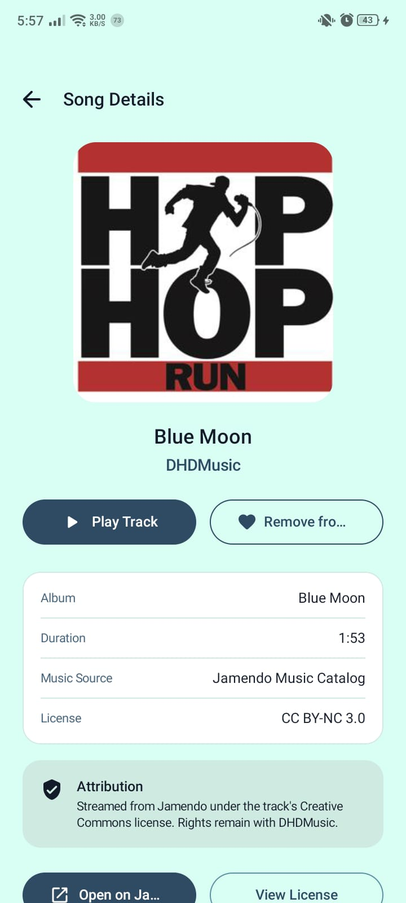 | 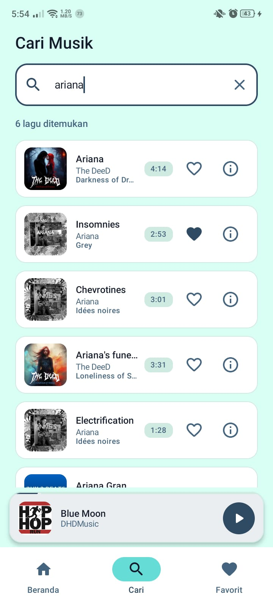 | 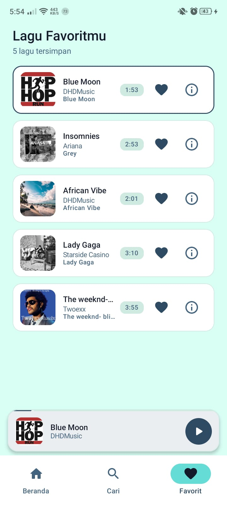 | 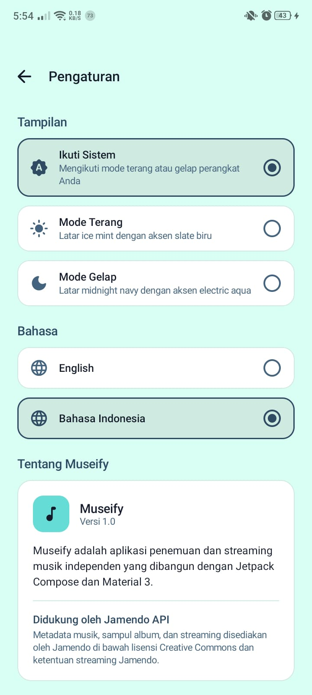 |

### 🌙 Mode Gelap (Dark Mode — English)
| Home Dashboard | Now Playing | Song Details | Search Music | Favorites | Settings |
|:---:|:---:|:---:|:---:|:---:|:---:|
| 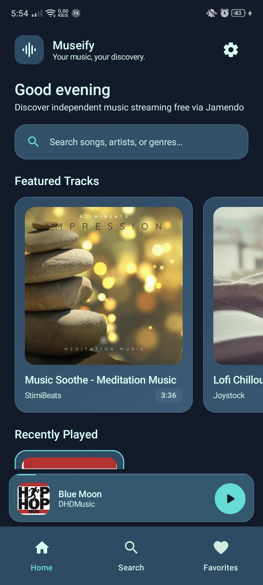 | 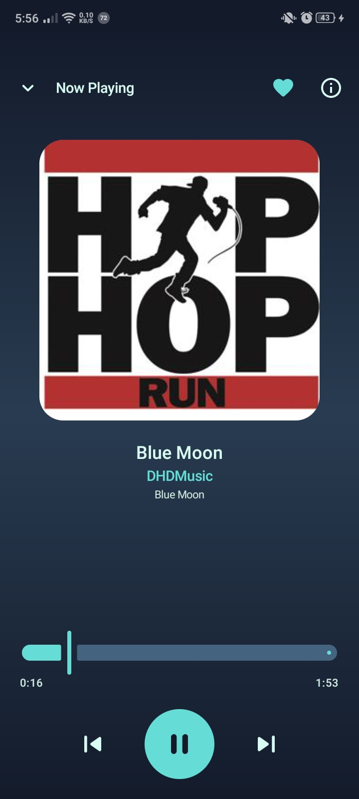 | 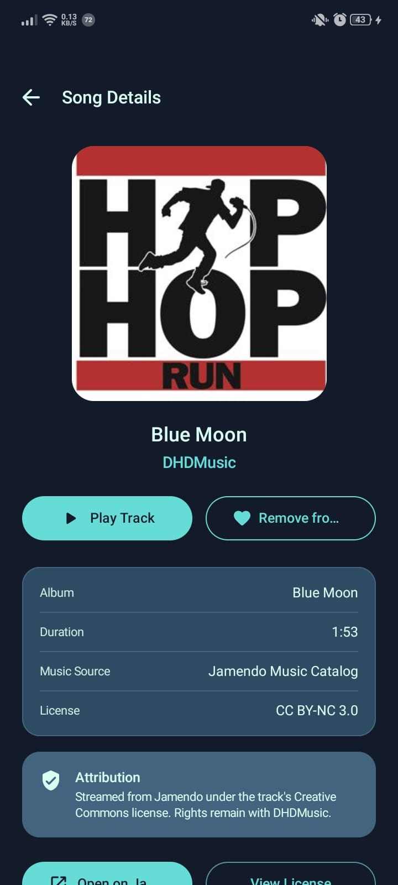 | 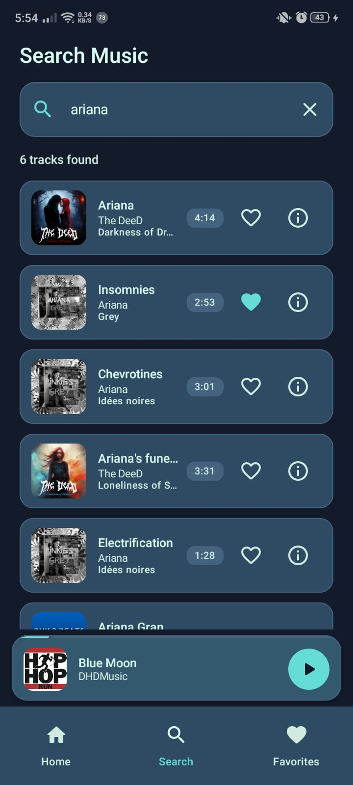 | 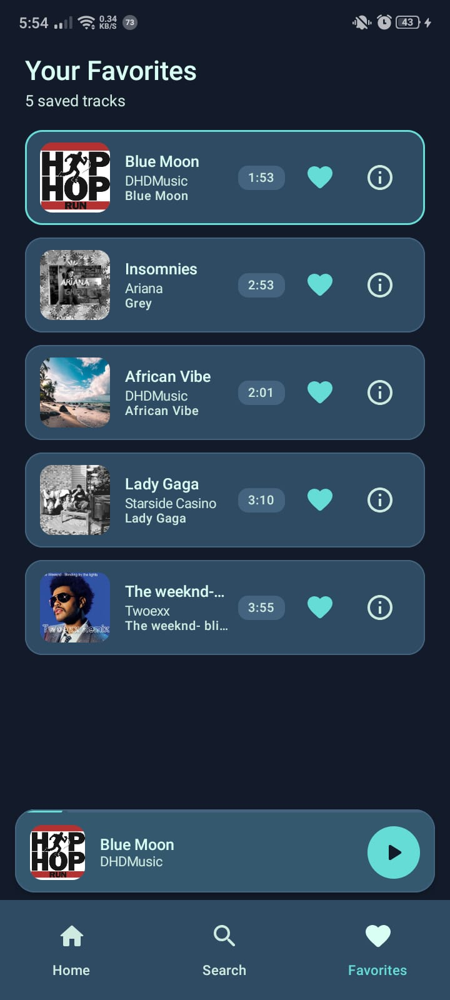 | 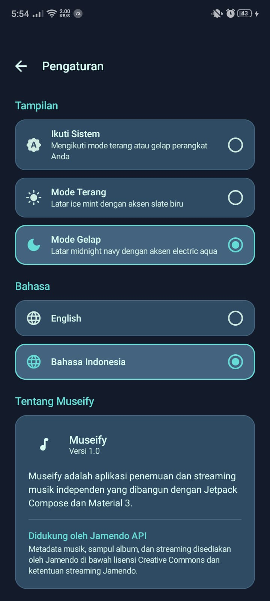 |

---

## 📱 Fitur Utama

### 1. Dashboard Interaktif (Halaman Utama)
- **Header Brand & Dynamic Greeting:** Sapaan otomatis sesuai waktu (*Selamat Pagi, Siang, Sore, Malam*).
- **Kolom Pencarian Cepat:** Akses langsung ke fitur pencarian musik.
- **Korsel Lagu Pilihan (Featured Tracks):** Menampilkan lagu-lagu populer menggunakan kartu besar horizontal (`LazyRow`).
- **Daftar Rekomendasi & Kurasi:** Menampilkan musik pilihan dalam susunan daftar vertikal yang nyaman dijelajahi.
- **Recently Played:** Menampilkan riwayat lagu yang baru saja diputar.

### 2. Tampilan Data Berbentuk Card & RecyclerView (LazyList)
- Mengambil data katalog musik secara asinkron dari **Jamendo REST API**.
- Seluruh data disajikan dalam komponen **Material 3 Card** yang dibungkus oleh **`LazyColumn` dan `LazyRow`** (implementasi deklaratif dari `RecyclerView` di Jetpack Compose).
- Pemuatan sampul album halus dengan *shimmer loading* dan *fade animation* menggunakan **Coil**.
- Setiap kartu dilengkapi judul, nama artis, durasi terformat (`m:ss`), tombol putar cepat, dan tombol simpan ke favorit.

### 3. Multi Bahasa (Multi-Language Support)
- Mendukung penuh dua bahasa:
  - 🇮🇩 **Bahasa Indonesia** (`res/values-in/strings.xml`)
  - 🇬🇧 **English** (`res/values/strings.xml`)
- Otomatis mengikuti bahasa sistem perangkat dan menyediakan opsi ganti bahasa langsung di menu **Pengaturan (Settings)**.

### 4. Mode Terang & Gelap (Not Night & Night Mode)
- **Mode Terang (Light Mode):** Tampilan bernuansa *Ice Mint* dan *Slate Blue*.
- **Mode Gelap (Dark Mode):** Tampilan bernuansa *Midnight Navy* dan *Electric Aqua*.
- Pengguna dapat memilih mode secara manual di Pengaturan atau mengikuti setelan sistem Android.

### 5. Responsif terhadap Rotasi Layar (Adaptive Layout)
- **Rotasi Layar Aman:** Saat ponsel diputar mendatar (*landscape*) atau diakses via tablet, tampilan tetap rapi, tidak ada elemen yang terpotong, dan tata letak beralih ke format 2-kolom (*two-pane layout*).
- **Dukungan Scroll:** Seluruh halaman tetap dapat di-scroll dengan lancar (`verticalScroll` & `LazyColumn`) tanpa menghentikan audio yang sedang diputar.

### 6. Pemutar Musik & Database Favorit
- **AndroidX Media3 ExoPlayer:** Pemutaran audio streaming MP3 berkualitas tinggi dengan kontrol Play/Pause, Next/Previous, dan bilah pencarian waktu (*scrubbing slider*).
- **Mini Player Persisten:** Pemutar mini mengambang yang selalu aktif di atas navigasi bawah.
- **Room Database:** Menyimpan lagu favorit secara offline dan permanen di penyimpanan lokal perangkat.
- **Halaman Detail & Lisensi:** Menampilkan rincian album, durasi lengkap, lisensi Creative Commons, dan tautan lagu di situs Jamendo.

---

## 🛠️ Tech Stack & Library

- **Bahasa:** Kotlin (`2.0.21`)
- **UI Toolkit:** Jetpack Compose (BOM `2024.09.00`) & Material 3 (`1.3.1`)
- **Arsitektur:** MVVM (Model-View-ViewModel) + StateFlow & Kotlin Coroutines
- **Networking:** Retrofit `2.11.0` + Gson Converter (`https://api.jamendo.com/v3.0/`)
- **Image Loader:** Coil Compose `2.7.0`
- **Audio Streaming:** AndroidX Media3 ExoPlayer `1.5.1`
- **Penyimpanan Lokal:** 
  - AndroidX Room `2.6.1` (KSP) untuk Database Favorit
  - AndroidX DataStore Preferences `1.1.1` untuk Tema & Bahasa
- **Navigasi:** Navigation Compose `2.8.5`

---

## 📂 Struktur Proyek

```text
com.biancaputri.museify
├── data/
│   ├── api/            # JamendoApi, DTOs, RetrofitInstance
│   ├── local/          # MuseifyDatabase (Room), FavoriteDao, FavoriteEntity
│   ├── model/          # Song domain model
│   ├── preferences/    # SettingsDataStore (Theme & Language)
│   └── repository/     # MusicRepository, FavoritesRepository
├── navigation/         # MuseifyNavigation (NavHost, BottomNav, NavigationRail)
├── player/             # MusicPlayerManager (Media3 ExoPlayer)
├── ui/
│   ├── components/     # SongCard, MiniPlayer, SearchBar, ArtworkImage, LoadingState
│   ├── screens/        # HomeScreen, SearchScreen, FavoritesScreen, NowPlayingScreen, SongDetailsScreen, SettingsScreen
│   ├── theme/          # Color, Theme, Type, Localization
│   └── util/           # AdaptiveLayout, Formatters
└── viewmodel/          # MusicViewModel, SettingsViewModel
```

---

## 🚀 Cara Menjalankan Aplikasi

1. Clone repositori ini:
   ```bash
   git clone https://github.com/biancaputri/Museify.git
   ```
2. Buka proyek di **Android Studio**.
3. Pastikan file `local.properties` (atau `secrets.properties`) memiliki Client ID Jamendo:
   ```properties
   JAMENDO_CLIENT_ID=your_jamendo_client_id_here
   ```
4. Lakukan **Gradle Sync**, lalu jalankan aplikasi pada emulator atau perangkat fisik Android (minSdk 24+).

---

## 📄 Atribusi Musik
Seluruh konten musik, sampul album, dan streaming disediakan oleh **Jamendo API** (`https://api.jamendo.com/v3.0/`) di bawah lisensi Creative Commons.
